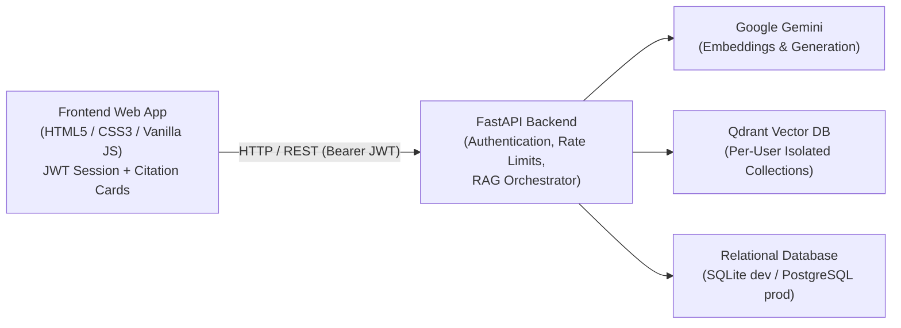

<div align="center">

# 🧠 DocuMind-RAG
### Enterprise Multi-Tenant RAG Engine with Qdrant, Google Gemini & Page Citations
*منظومة استرجاع وتوليد معزز (RAG) مؤسسية متعددة المستخدمين مع بحث شعاعي عبر Qdrant وتوثيق دقيق لمصادر الصفحات*

<br/>

[](https://www.python.org/)
[](https://fastapi.tiangolo.com/)
[](https://qdrant.tech/)
[](https://ai.google.dev/)
[](https://github.com/alhaj-ai/DocuMind-RAG)
[](tests/)
[](LICENSE)

<br/>

**Engineered by [Mohammed AL-Haj](https://github.com/alhaj-ai)**  
*AI Engineer | LLMs, Multi-Agent Systems & RAG Architectures*  
📍 *Sana'a, Yemen* · [LinkedIn](https://www.linkedin.com/in/mohammed-mohammed-al-haj-341ab7369) · [GitHub](https://github.com/alhaj-ai) · `ai.mohammed.alhaj@gmail.com`

---

</div>

## 🌟 Overview

**DocuMind-RAG** is a production-grade, full-stack Retrieval-Augmented Generation (RAG) platform that enables users to upload PDF documents and converse with them naturally in Arabic and English.

Unlike basic tutorial RAG implementations, **DocuMind-RAG** is engineered for real-world enterprise deployments with:
- **Zero-Trust Multi-Tenancy**: Complete per-user data isolation at the vector database layer (each user gets an isolated Qdrant collection).
- **Strict Factual Grounding**: Answers are anchored exclusively in document excerpts, accompanied by exact document and page-level citations (e.g. `financial_report.pdf (p.4)`).
- **Hybrid Intelligent Routing**: Answers document-specific queries from context while gracefully serving general inquiries in assistant mode with `<no_sources>` markers.
- **Bilingual Arabic & English Support (دعم كامل للغة العربية)**: Seamless processing of Arabic PDF documents, Arabic query semantics, and Right-to-Left (RTL) friendly responses.
- **Enterprise Security & Privacy**: JWT-based session security, salted bcrypt password hashing, and full GDPR compliance (instant deletion of document vectors or full account wiping).

---

## 🏛️ System Architecture



### Complete Ingestion & Retrieval Pipeline

| Step | Operation | Technical Mechanism | Module |
|:---|:---|:---|:---|
| **1. Ingestion** | PDF Text Extraction | Extracts raw page text while preserving page number offsets | `rag/loader.py` |
| **2. Chunking** | Overlapping Segmentation | Splits text into 1,000-character chunks with 200-character overlaps & page metadata | `rag/chunker.py` |
| **3. Embedding** | Vector Generation | Converts text chunks into high-dimensional vectors via Google Gemini API | `rag/embedder.py` |
| **4. Indexing** | Isolated Storage | Upserts vectors with payload into the user's private Qdrant collection | `rag/vectorstore.py` |
| **5. Retrieval** | Cosine Similarity | Queries Qdrant for top-$k$ relevant chunks for incoming inquiries | `rag/vectorstore.py` |
| **6. Synthesis** | Citation Grounding | Synthesizes response with Gemini and appends de-duplicated page citations | `rag/chain.py` |

---

## ✨ Production Features

- **Document Ingestion**: Fast parallel chunking and embedding of multi-page PDFs.
- **Page-Level Grounding**: Every answer backed by verified document names and page numbers.
- **Multi-Tenant Privacy**: User A cannot access, query, or leak User B's indexed vectors.
- **Automated Resiliency**: Automatic retries with exponential backoff on Gemini rate limits (429) or transient errors (5xx).
- **Observability**: Request tracing with unique `X-Request-ID` headers, structured logging, and optional Sentry error monitoring.
- **100% Offline-Mockable Tests**: 17 unit and integration tests executing in <8 seconds without requiring external API credentials.

---

## 🚀 Quickstart Guide

### 1. Clone the Repository
```bash
git clone https://github.com/alhaj-ai/DocuMind-RAG.git
cd DocuMind-RAG
```

### 2. Set Up Virtual Environment & Dependencies
```bash
python -m venv venv

# Windows
venv\Scripts\activate

# Linux / macOS
source venv/bin/activate

pip install -r requirements.txt
pip install -r requirements-dev.txt
```

### 3. Configure Environment Variables
Copy the template configuration:
```bash
cp .env.example .env
```
Add your Google Gemini API Key in `.env`:
```env
GOOGLE_API_KEY=your_gemini_api_key_here
JWT_SECRET=your_super_secret_jwt_key
```

### 4. Run the Application
```bash
python -m uvicorn api:app --host 127.0.0.1 --port 8000 --reload
```
Access the application at **[http://127.0.0.1:8000](http://127.0.0.1:8000)**.
Interactive Swagger API documentation is available at **[http://127.0.0.1:8000/docs](http://127.0.0.1:8000/docs)**.

---

## 🧪 Automated Testing

DocuMind-RAG includes a test suite that mocks Gemini API responses for fast, deterministic, offline execution:

```bash
python -m pytest tests/ -v
```

**Results:**
```
tests/test_api_auth.py::test_register_login_and_me PASSED
tests/test_api_auth.py::test_duplicate_email_rejected PASSED
tests/test_api_auth.py::test_short_password_rejected PASSED
tests/test_api_auth.py::test_wrong_password_rejected PASSED
tests/test_api_auth.py::test_protected_routes_require_token PASSED
tests/test_api_rag.py::test_process_then_ask PASSED
tests/test_api_rag.py::test_ask_without_documents_answers_generally PASSED
tests/test_api_rag.py::test_user_documents_are_isolated PASSED
tests/test_api_rag.py::test_delete_my_documents PASSED
tests/test_api_rag.py::test_delete_my_account PASSED
tests/test_api_rag.py::test_health_telemetry PASSED
tests/test_rag.py::test_split_documents_keeps_metadata PASSED
tests/test_rag.py::test_embed_chunks_preserves_order PASSED
tests/test_rag.py::test_format_sources_dedups_and_keeps_order PASSED
tests/test_security.py::test_password_hash_and_verify PASSED
tests/test_security.py::test_jwt_token_roundtrip PASSED
tests/test_security.py::test_config_validate_flags_insecure_production PASSED

======================= 17 passed in 7.54s =======================
```

---

## 📡 REST API Reference

| Method | Endpoint | Access | Description |
|:---|:---|:---|:---|
| `GET` | `/health` | Public | Microservice health check & telemetry |
| `POST` | `/register` | Public | Create new user account |
| `POST` | `/login` | Public | Authenticate user & issue JWT token |
| `GET` | `/me` | Protected | Current authenticated user profile |
| `POST` | `/process` | Protected | Upload and index PDF documents |
| `POST` | `/ask` | Protected | Ask natural language question with citations |
| `GET` | `/status` | Protected | Check if user's documents are indexed |
| `DELETE` | `/me/documents` | Protected | Delete user's document vectors (GDPR) |
| `DELETE` | `/me` | Protected | Wipe entire user account and data |

---

## 🐳 Docker Deployment

Deploy the entire containerized stack (API + Qdrant Vector DB + PostgreSQL) in one command:

```bash
docker compose up --build
```
Open **[http://localhost:8000](http://localhost:8000)** in your browser.

---

## 📁 Repository Structure

```
DocuMind-RAG/
├── auth/
│   ├── security.py         # JWT generation, verification & bcrypt hashing
│   └── __init__.py
├── db/
│   ├── database.py         # SQLAlchemy engine & session manager
│   ├── models.py           # User and Document database schemas
│   └── __init__.py
├── rag/
│   ├── chain.py            # Gemini prompt formatting & answer synthesis
│   ├── chunker.py          # Sliding-window document chunking
│   ├── citations.py        # De-duplicated page citation formatter
│   ├── embedder.py         # Concurrent vector embedding generator
│   ├── loader.py           # PDF page-by-page text extractor
│   ├── service.py          # Unified RAG ingestion & querying service
│   ├── vectorstore.py      # Qdrant client & per-user collection manager
│   └── __init__.py
├── frontend/
│   ├── index.html          # Authentication & registration UI
│   ├── chat.html           # Document chat interface with citations
│   └── static/             # CSS styling and modular JavaScript clients
├── tests/                  # Unit and integration test suite (17 tests)
├── api.py                  # FastAPI RESTful endpoints & middleware
├── config.py               # Centralized configuration & validation
├── gemini_client.py        # Shared Gemini client with exponential backoff
├── observability.py        # Logging & request tracing
├── Dockerfile              # Production container recipe
├── docker-compose.yml      # Multi-container orchestration
├── requirements.txt        # Runtime dependencies
├── requirements-dev.txt    # Testing & development dependencies
├── LICENSE                 # MIT License (Copyright 2026 Mohammed AL-Haj)
└── README.md               # Architecture documentation & guide
```

---

## 👤 Author

**Mohammed AL-Haj (محمد الحاج)**  
*AI Engineer | LLMs, Multi-Agent Systems, RAG & Computer Vision*  
Sana'a, Yemen (صنعاء، اليمن)

- **GitHub:** [@alhaj-ai](https://github.com/alhaj-ai)
- **LinkedIn:** [Mohammed AL-Haj](https://linkedin.com/in/mohammed-mohammed-al-haj-341ab7369)
- **Email:** [ai.mohammed.alhaj@gmail.com](mailto:ai.mohammed.alhaj@gmail.com)

---

## 📄 License

This project is licensed under the **MIT License** — see the [LICENSE](LICENSE) file for details.
